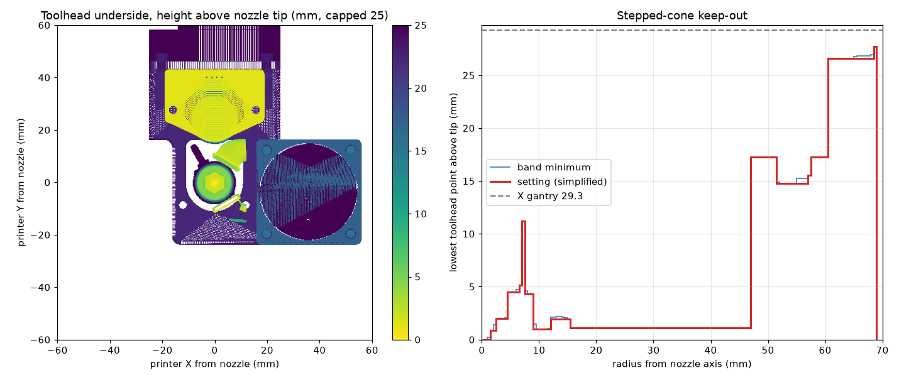

# Toolhead clearance (non-planar printing)

How far below the toolhead the nozzle tip sticks out, measured on the rCAD printer model
(`X-carriage-no-belts.json`, Printer assembly, Goliath hotend from PR #7). Non-planar
features in the OrcaSlicer fork (Z anti-aliasing, non-planar infill) use this so the
toolhead doesn't plough into the part. It is set with the fork's `toolhead_clearance_*`
printer settings.



## Numbers (2026-11-24)

Heights are above the nozzle tip. Positions are in printer (firmware) axes from the
nozzle: +X right, +Y back (CAD X = firmware Y, CAD −Y = firmware X).

| Part | Lowest point | Where |
|---|---|---|
| Nozzle / Goliath | 0 at the tip, 0.24 at r 1.5, 0.85 at r 2, 1.41 at r 2.5, 2.0 out to r 4.5 | cone, then the heater block (4.3–5 mm out to r 9) |
| **Part cooling duct outlets** | **1.00** | r 10.9–11.5, two lips either side of the nozzle (lowest at X +0.8 Y −11.2) |
| **Beacon RevH PCB** | **1.14** | X −19…+19, Y +15.6…+43.1 (behind the nozzle), r 15.6–46.5 |
| Probe mount, Beacon housing | 2.75 | behind the nozzle |
| Carriage screws, fan plate | 14.75–22 | r > 47 |
| X gantry (beam, ends) | 29.25 | spans the bed |

So within about 47 mm of the nozzle, nothing may stand more than **1.0 mm** above the
nozzle tip (the duct). The Beacon at 1.14 mm covers the biggest area. The Beacon's two
round sensing bodies (drawn 1.46 and 0.40 mm *below* the tip) aren't solid and are left out.

**Check on the real machine:** the model's Beacon and duct heights are not measured on
the printer (see `notes/purge-bucket.md`: Jonas hasn't measured the Beacon height yet).
The part cooling duct body is also one of the model's broken bodies: OCCT drops 35 of
its 56 faces. Its vertices are where Onshape put them, so its lowest point should hold,
but the face coverage of the height map is incomplete there. Re-run this after the duct
STEP is re-imported (HANDOFF section 5) and once the Beacon height is measured.

## Files

- `toolhead-clearance.json`: the full profile (`profile_steps`, 0.5 mm bands, each band's
  lowest point), a simplified one for the setting (`profile_simple`, never higher than
  the full one), every part's lowest point, the gantry height and the strings to paste
  into OrcaSlicer (`orca`).
- `toolhead-nozzle-frame.stl`: the toolhead in the nozzle frame (tip at the origin,
  firmware axes, Z up), clipped above 30 mm. No gantry, which the profile's last step
  covers. For `toolhead_clearance_mesh`.
- `toolhead-underside.png`: height map and profile.

## OrcaSlicer fork settings (printer → Extruder clearance)

```
toolhead_clearance_enable  = 1
toolhead_clearance_profile = 1.5x0, 2.5x0.85, 4.5x2, 6.5x4.5, 7x5.15, 7.5x11.19, 9x4.33, 12x1, 15.5x1.95, 47x1.13, 51.5x17.25, 57x14.75, 57.5x15.52, 60.5x17.25, 68.5x26.6, 69x27.74, 1000x29.2
toolhead_clearance_mesh    = /home/jonas/t3/simplecore/simplecore/clearance/toolhead-nozzle-frame.stl   (optional)
toolhead_clearance_margin  = 0.2
```

The profile is a radius × height list. Within each radius, nothing hangs lower than
that height. The last step (1000 × 29.2) is the gantry. With the mesh set as well, the
fork uses the lower of the two at each point. The mesh is tighter than the profile:
most of the circle around the nozzle is open, and only the duct lips and the Beacon
come down.

## Re-running

```bash
python3 scripts/clearance/mkrun.py X-carriage-no-belts.json /tmp/thobj > /tmp/thobj/run.json
rcad run /tmp/thobj/run.json          # exports the toolhead + gantry Part Studios as OBJ, ~3 min
python3 scripts/clearance/derive.py X-carriage-no-belts.json /tmp/thobj clearance
```

This skips the Printer assembly (opening it and meshing every part times out rCAD's
600 s kernel limit on a busy netdash). Instead it exports each Part Studio the toolhead
and gantry use, then places the bodies with the assembly poses from the JSON. The
Sherpa (on top) and the frame are skipped.
