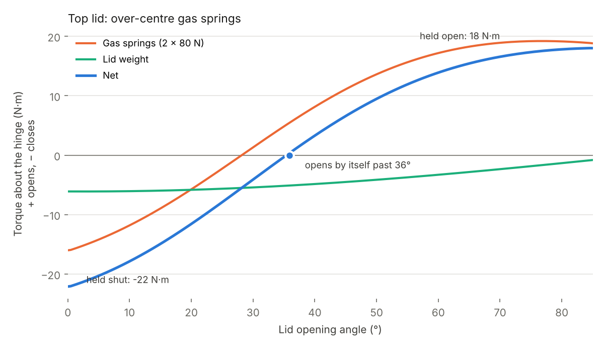

# Top lid with over-centre gas springs and a seal

The top panel is now a lid hinged along the back. Two gas springs pull it shut when it is closed and push it open past about 42°, and it stays up at 90° by itself. A hollow silicone seal runs round the top of the frame. The top PIR board is bonded under the lid, so it lifts out of the way with it.


## How it works

| | |
|---|---|
| Hinge | Two 50 × 50 × 1.5 stainless butt hinges at y 40–90 and 363–413, laid flat, pin along Y at x 441, z 598.95 (just behind the lid's back edge). The frame leaf sits on an 8 mm aluminium spacer on the rear-most top rail (x 454.5–474.5), held by an M5 T-nut. |
| Lid | 3 mm 6061, the same 459 × 508 footprint as the old top panel (x −25.5..433.5, y −27.5..480.5). It sits on the seal, so it is now at z 595.2–598.2 (5 mm higher). |
| Insulation | The old top board (25.4 mm PIR) is bonded under the lid: x −3.5..402.5, y −1.5..454.5, z 569.8..595.2. It is 2 mm clear of the top extrusions all round. When the lid opens it swings up and forward, away from the rear rail. At the front it moves at most 1 mm forward before it rises, so the 2 mm gap clears. |
| Seal | Self-adhesive hollow silicone D-profile, about 10 wide × 8 high, on the top face of the four top extrusions (centred on each rail; centre-line rectangle 430 × 480, about 1.82 m). It is modelled compressed to 5 mm. A close catalogue profile is Parker TechSeal hollow-D D010 (12.4 × 7.9) with the PSA backing, ordered in silicone. |
| Gas springs | Two, one on each side, OUTSIDE the side panels (y −45 and 498), so they stay at room temperature and clear of everything in the chamber: the cable chain at the back, the webcam on the right wall. Size: 150 mm extended (ball to ball), 50 mm stroke (100 compressed), Ø15 body, Ø6 rod, **100 N** each, Ø10 ball sockets on M6 ball studs. For example Bansbach easylift (made to length and force). Ordering one with a bleed valve at 120 N lets you tune it down. |
| Brackets | Machined 6061, flat plates. **Frame bracket** (8 mm, x 262–304, z 513–590.2) sits on the side panel with 2× M5 through the panel into the top side rail's slot at z 580; ball stud at (282.5, 523.45). **Lid bracket** (6 mm plate 2 mm off the panel + a 6 mm flange on the lid top with 2× M4); ball stud at (403.5, 538.95) when closed. |

### Over-centre numbers

From `scripts/lid/torque_plot.py` (lid + PIR + brackets ≈ 2.6 kg, CG 236 mm in front of the pin, 100 N springs with F2/F1 = 1.3):



- **Closed:** 18.7 N·m holding it shut (12.7 from the springs, 6.0 from the lid's weight). That is about 80 N on the seal (≈ 4.4 N per 100 mm), and you lift with about 40 N at the front edge to open it.
- **Springs' dead point:** 32°, where they are shortest (104.8 mm, 4.8 mm before they bottom out).
- **Past 42°** it opens by itself. **At 90°** the springs hold it open with 13.8 N·m and are fully extended (150 mm), so the springs themselves are the end stop. Closing works the other way round: push it down past 42° and it pulls itself shut.
- The torques scale with spring force: 80 N springs give 16.2 N·m shut / 11.0 N·m open, 120 N give 21.3 / 16.6.
- Spring length over the swing: 122.0 (closed) → 104.8 (32°) → 150 (90°), checked in the assembly (the mates solve the loop: no failed mates at 0°, 32° and 90°).

`scripts/lid/search.py` is the search that picked the geometry: ball positions on a grid, spring sizes 150/50 to 305/130, keeping the ones that hold shut and open with the ball points outside the panels and above the Trad Rack.

## Clearances

- Toolhead: the toolhead never moves in Z (the bed does). Its top (cable chain mount) is at z 537.0, the lid's insulation at 569.8: **32.8 mm**, 5 mm more than under the old board. The X gantry tops out at 468.9. The cable chain itself is not modelled; it has those 32.8 mm to arc in.
- Right side: the Trad Rack's highest point is z 397.8, 115 mm below the frame bracket. Nothing else is on the outside of either side panel above z 500.
- Back: hinges and spacers sit on the rear-most top rail, outside the back panel. Nothing inside the chamber.
- Door: its top is at 590.2 and in front of x −28.8; the lid starts at x −25.5, 5 mm higher. No change.
- Lid swing (0–90°): the lid bracket comes no closer than 50 mm to the frame bracket; the lid's back edge passes 5 mm in front of the hinge spacers.

## Model

- Part Studios **Top lid** (sketch-and-extrude features in world position, variables `lid_t`, `seal_h`, `lid_pir_t`) and **Lid gas springs** (spring body, rod and ball stud imported as STEP in local frames).
- Assemblies **Top lid** (moves: panel, PIR, lid leaves, lid brackets, lid ball studs) and **Lid frame hardware** (fixed: seal, frame leaves, spacers, frame brackets, frame ball studs).
- In **Printer**: both, plus each spring's body and rod. Mates: **Top lid hinge** (revolute, 0..90°; mate 24 in X-carriage.json, 22 in X-carriage-no-belts.json), each body on the lid's ball (revolute), each rod on the frame's ball (revolute), body and rod on one axis (cylindrical). The motion slider **Open top lid** opens it 0 → 90° and the springs follow.
- The old top panel (Enclosure) and the old top PIR board (PIR insulation) are hidden, not deleted.

## Rebuild

```
rcad script scripts/lid/hw.rhai                 # gas spring + ball stud STEPs
python3 scripts/lid/mklid.py .                  # lid_run.json
rcad run lid_run.json                           # lid-doc.json
python3 scripts/lid/splice_lid.py lid-doc.json X-carriage.json   # -> X-carriage.json.new (only adds; hides the two old parts)
```

## Not checked / open

- The real top insulation: the CAD had a 25.4 mm PIR board in the top bay; if your sheet is a different thickness or sits under the rails, the plug changes.
- Seal compression force is an estimate for a soft hollow profile; the closed torque gives ≈ 80 N over 1.82 m. If the profile you buy is much stiffer, go up a spring force.
- The springs act as the 90° end stop. A rubber bump stop on the rear rail would take that load off them.
- No latch or handle: the springs hold it shut. A finger pull on the front edge would help.
