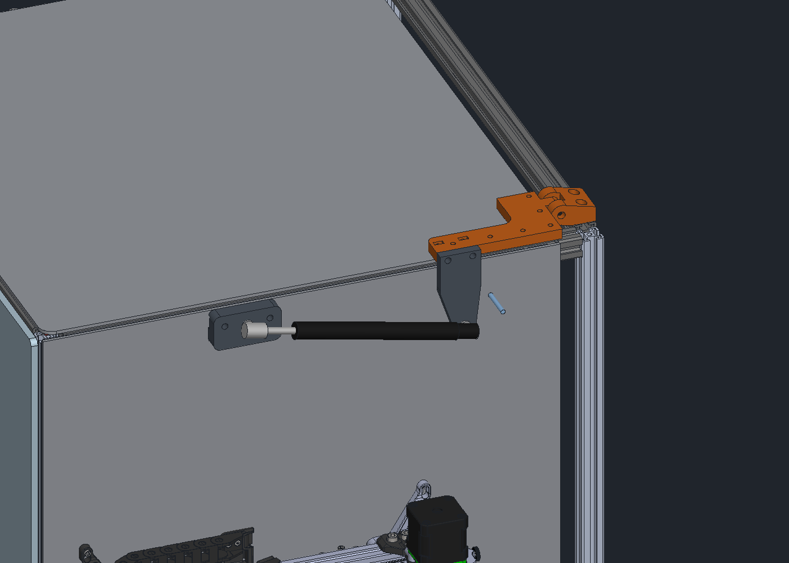
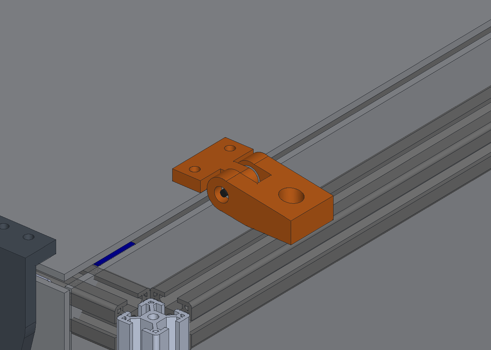
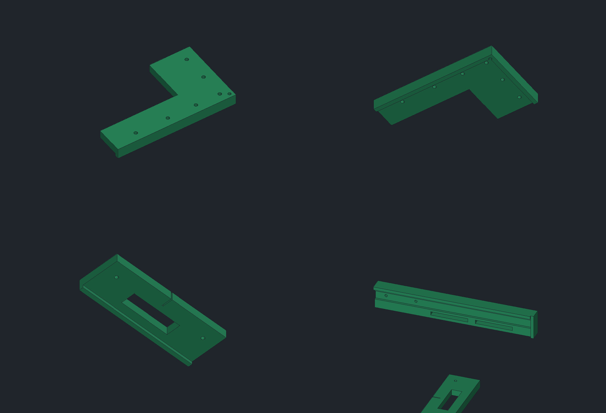

# Top lid with over-centre gas springs and a seal

The top panel is now a lid hinged along the back on two printed corner hinges that turn on 623 ball bearings. Two gas springs pull it shut when it is closed and push it open past about 28°, and it stays up at 85° by itself. A hollow silicone seal runs round the top of the frame. The top PIR board is bonded under the lid, so it lifts out of the way with it.

Rev 3 (2026-11-22): heavier hinges moved to the lid's rear corners, each one printed in one piece with an arm that runs forward along the lid's side edge to the spring lever, so the spring force goes lever → arm → pin and not through the 3 mm lid. The springs and their brackets moved forward so that everything outside the side panel is in front of the filament tube, and the brackets clear the M5 button heads that hold the side panels.

Rev 4 (2026-11-25): geometry redone for the struts Jonas bought (HUOPO 10 in / 18 lb kit, measured: 245 mm ball centre to ball centre extended, 150 compressed, so 95 mm of stroke) and their ball studs on Ø29 screw plates. The levers and frame brackets now take the kit plates (3× M4 on a Ø20 circle), the balls moved (frame (175.5, 571), lid (344, 551.95)), and the frame bracket holes are placed clear of the side panels' own screws, which were measured from photos.

Rev 4.1 (2026-11-26): the spring levers and frame brackets are printed instead of machined, and take the kit plates on M4 heat-set inserts. Each is 4 mm thicker, outward, so the balls and springs moved 4 mm out (ball centres at y −58.5 on the right). The handle takes 2 M3 heat-set inserts. The corner arms' outer edge is 0.1 mm in from the lever, so the two never share a face in the STL export.


Open: drag the slider on the 3D page (`lid/web/top-lid-only.html`); the open-position renders were for rev 3 and have been removed.



## How it works

| | |
|---|---|
| Hinges | Two printed hinges at the lid's rear corners (y 14 and 439), pin along Y at x 444, z 601.95 (just behind the lid's back edge). Each has a **frame block** on the rear-most top rail (x 454.5–474.5, 2× M5 into T-nuts) with two 10 mm ears, a **623 bearing (3 × 10 × 4)** pressed into each ear from the slot side with 4.5 mm of plastic round it, and a **corner arm** whose 12 mm tongue sits between the ears. An M3 × 25 screw with a locknut goes through both bearings and the tongue and clamps the inner races against the tongue, so the screw turns with the lid in the bearings. |
| Corner arms | One printed part per side, 127.5 × 66.5 × 11: a 9.25 mm pad over the lid's rear corner that carries the tongue, and a 24.5 mm wide strip along the lid's side edge forward to x 322. 6× M4 into the lid, all outside the seal line (three at x 426.5, three along the edge at x 340, 373, 402). The spring lever bolts to the strip's outer side with 2× M5 × 35 (nuts in slots in the strip). |
| Lid | 3 mm 6061, the same 459 × 508 footprint as the old top panel (x −25.5..433.5, y −27.5..480.5), front corners rounded R12. It sits on the seal, so it is now at z 595.2–598.2 (5 mm higher). |
| Insulation | The old top board (25.4 mm PIR) is bonded under the lid: x −3.5..402.5, y −1.5..454.5, z 569.8..595.2. It is 2 mm clear of the top extrusions all round. When the lid opens it swings up and forward, away from the rear rail. |
| Seal | Self-adhesive hollow silicone D-profile, about 10 wide × 8 high, on the top face of the four top extrusions (centred on each rail; centre-line rectangle 430 × 480, about 1.82 m). It is modelled compressed to 5 mm. A close catalogue profile is Parker TechSeal hollow-D D010 (12.4 × 7.9) with the PSA backing, ordered in silicone. |
| Gas springs | Two, one on each side, OUTSIDE the side panels (ball centres at y −54.5 and 507.5), so they stay at room temperature and clear of everything in the chamber. Jonas's **HUOPO 10 inch / 18 lb (80 N)** pair: **245 mm extended ball centre to ball centre, 150 mm compressed (95 mm stroke)**, Ø10 ball sockets. The body and rod diameters in the model (15 / 6) are the usual ones, not measured. |
| Ball studs | The kit's own: a Ø10 ball on a Ø29 round plate with 3 Ø4.5 holes on a Ø20 circle (from Jonas's photo, scaled to his Ø29), 19 mm from the plate's back to the top of the ball, so the ball centre is 14 mm off the plate. Each plate screws to the outer face of a lever or bracket with 3× M4 × 8 into M4 heat-set inserts (Ø5.6 × 9 deep holes, for M4 × 8.1 × Ø5.6 inserts); a Ø9 hole behind the plate's centre clears the stud's rivet. One plate hole points straight up. |
| Lid spring levers | Printed 12 mm plates (y −44.5..−32.5 on the right), x 322–360, z 536–607.45, hanging outside the side panels 5 mm off them (2.2 mm over the 2.75 mm button heads). R16 round end for the ball plate, ball at (344, 551.95) when closed. |
| Frame brackets | Printed 17 mm blocks, 64 × 38.2 (x 143.5–207.5, z 552–590.2), on the side panels with 2× M5 × 25 through the panel into the top side rail's slot (x 153.5 and 197.5, z 580: 179 and 223 mm from the panel's front edge). A 12 × 3.2 mm channel runs along the back at z 574–586 over the panel's M5 button heads (one, at x ≈ 178.5, sits under each bracket). Ball plate at (175.5, 571). The bracket holes are at least 19 mm from the panel's own screws. |
| Handle | Printed arch at the middle of the front edge, 110 long, 22 high, with an 80 × 16 finger opening. 2× M3 × 8 from under the lid into M3 heat-set inserts in its legs (Ø4.5 × 6 deep holes, for M3 × 5 × 4 inserts; 95 mm apart), fitted before the insulation is bonded on. |

### Over-centre numbers

From `scripts/lid/torque_plot.py` (lid + PIR + arms ≈ 2.6 kg, CG 239 mm in front of the pin, 80 N springs with F2/F1 = 1.3):


- **Closed:** 18.0 N·m holding it shut (11.9 from the springs, 6.1 from the lid's weight). That is about 75 N on the seal (≈ 4 N per 100 mm), and you lift with about 38 N at the front edge to open it.
- **Springs' dead point:** 20°, where they are shortest (158.5 mm, 8.5 mm before they bottom out at 150).
- **Past 28°** it opens by itself. **At 85°** the springs hold it open with 17.1 N·m and are fully extended (245 mm), so the springs themselves are the end stop. Closing works the other way round: push it down past 28° and it pulls itself shut.
- Spring length over the swing: 169.6 (closed) → 158.5 (20°) → 245 (85°). Highest spring force 102 N per side.

`scripts/lid/search.py` is the search that picked the geometry: spring sizes, open angles and ball positions, keeping the ones that hold shut and open with the lid ball at least 27 mm in front of the filament tube hole and the frame ball beside the top side rail.

## Clearances

- Toolhead: the toolhead never moves in Z (the bed does). Its top (cable chain mount) is at z 537.0, the lid's insulation at 569.8: **32.8 mm**, 5 mm more than under the old board. The X gantry tops out at 468.9. The cable chain itself is not modelled; it has those 32.8 mm to arc in.
- Filament tube (right side): from the photos its hole is about 36 mm below the panel's top edge and 62 mm in front of its rear edge, about (371.5, 554), and the tube runs back and down along the rear edge. Everything on the outside of the panel is in front of it: the lever's rear edge is at x 360 when closed (9.5 mm from the tube; the lid ball stays 27.6 mm from the tube's centre over the whole swing) and moves forward and up as the lid opens; the spring is always in front of the lever. The tube stub is in the model as a reference part.
- Side panel screws (right panel, measured from two photos with a 25 × 50 × 75 block for scale, 2026-11-25; Jonas: evenly spaced): 8 M5 button heads (2.75 high) along the top edge, 10.2 mm below it, about 51 mm apart (x ≈ 25.5, 76.5 … 382.5, i.e. 51, 102 … 408 mm from the front edge), and columns about 10 mm in from the front and rear edges. The levers pass 2.2 mm over them, the frame brackets have the channel, and nothing sits on the rear edge any more.
- Right side: the Trad Rack's highest point is z 397.8, 130 mm below the springs.
- Back: the hinge blocks sit on the rear-most top rail, outside the back panel. Nothing inside the chamber.
- Door: its top is at 590.2 and in front of x −28.8; the lid starts at x −25.5, 5 mm higher. No change.
- Lid swing (0–85°): rev 3 passed an interference check at 0°, 42.5° and 85°. Rev 4 is checked closed in the assembly (no failed mates; the only overlaps are the modelled ball sockets round their balls and the rod inside the body) and over the swing in 2D (`torque_plot.py`: the lid ball stays 27.6 mm from the tube, the springs stay 8.5 mm short of bottoming out); the lever and arm parts above the panel did not change.

## Model

- Part Studios **Top lid** (sketch-and-extrude features in world position, variables `lid_t`, `seal_h`, `lid_pir_t`) and **Lid gas springs** (spring body, rod and ball stud imported as STEP in local frames).
- Assemblies **Top lid** (moves: panel, PIR, handle, corner arms and pins, spring levers, lid ball-stud plates) and **Lid frame hardware** (fixed: seal, hinge blocks with their bearings, frame brackets, frame ball-stud plates, the filament tube reference).
- In **Printer**: both, plus each spring's body and rod. Mates: **Top lid hinge** (revolute, 0..85°; mate 24 in X-carriage.json, 22 in X-carriage-no-belts.json), each body on the lid's ball (revolute), each rod on the frame's ball (revolute), body and rod on one axis (cylindrical). The motion slider **Open top lid** opens it 0 → 85° and the springs follow.
- The old top panel (Enclosure) and the old top PIR board (PIR insulation) are hidden, not deleted.

## Interactive 3D page

`lid/web/top-lid-only.html` is rCAD's `export_web` page of the lid, hinges, springs and seal on their own (0.5 MB, needs internet for three.js). Drag the **Open top lid** slider or press Play. The page for the whole printer is 31 MB without the Trad Rack (120 MB with it), so it is not in the repository; build it with:

```
python3 scripts/lid/web_export.py X-carriage.json Printer lid_geom.json printer-with-top-lid.html "--hide=Trad Rack" && rcad run web_run.json
```

The page does not solve closed loops, so the gas springs would come apart as the lid opens. `web_export.py` works on a temporary copy: it suppresses the springs' sliding mates and makes the **Open top lid** slider drive the four ball joints with the angles the springs really take, so they stay in line. The single **Top lid hinge** slider further down moves the lid alone, without the springs. The documents themselves are unchanged.

## Printed parts

STLs in print orientation are in `lid/print/` (ASA or ABS; the hinges sit outside the chamber on top of the frame).

| Part | Qty | Orientation | Supports |
|---|---|---|---|
| `lid-hinge-frame-block.stl` (40 × 21.2 × 32.6) | 2 | On its side, pin axis upright, so the layers run along the ears | Only in the 12.6 mm slot between the ears |
| `lid-corner-arm-right.stl`, `lid-corner-arm-left.stl` (127.5 × 66.5 × 11) | 1 each | Top face down | None (the nut slots bridge 8.3 mm) |
| `lid-handle.stl` (110 × 22 × 14) | 1 | On its front face | None |
| `lid-spring-lever-right.stl`, `-left.stl` (38 × 71.5 × 12) | 1 each | Flat, outer face (insert holes) up | None |
| `lid-frame-bracket-right.stl`, `-left.stl` (64 × 38.2 × 17) | 1 each | Flat, outer face (insert holes) up | None (the 12 mm channel underneath bridges) |

Hardware: 4× 623 bearing, 2× M3 × 25 socket screw + locknut, 4× M5 × 12 + T-nut (blocks), 12× M4 (corner arms), 4× M5 × 35 + nut (levers), 4× M5 × 25 + T-nut (frame brackets), the strut kit's 4 ball-stud plates with 12× M4 × 8 into 12× M4 heat-set inserts (M4 × 8.1 × Ø5.6, in the levers and brackets), 2× M3 × 8 into 2× M3 heat-set inserts (M3 × 5 × 4, in the handle). The insert holes are sized for those inserts; if yours differ, change `M4_INS_R` / `M3_INS_R` in `mklid.py`. The bearing pockets are drawn at exactly 10.0 mm, so set your usual press-fit allowance in the slicer or ream them. The screw head and the nut sit in 6.8 mm bores in the ears and bear on the inner races only; hold the nut with needle-nose pliers.

## Drilling jigs

Printed jigs for the holes you drill yourself, in `lid/jigs/` (STLs lips-up, no supports; any filament; model `lid-drill-jigs.json`, built by `scripts/lid/mkjigs.py` and `jig_files.py`). Every guide hole is 3.4 mm for a 3.3 mm pilot drill; open the holes up afterwards (4.3 for M4, 5.5 for M5). Run the drill through the printed guides once before use.



| Jig | Qty | Registers on | Holes |
|---|---|---|---|
| `lid-jig-corner-right.stl`, `-left.stl` (121.5 × 71.5 × 10.8) | 1 each | Top of the lid, lips against the lid's rear edge and side edge | The corner arm's 6× M4: three 7 mm in front of the rear edge, three 4.5 mm in from the side edge |
| `lid-jig-handle.stl` (41.5 × 120 × 10.8) | 1 | Top of the lid, lip against the front edge; line the sight slot up with a centre line scribed 254 mm from either side edge | The handle's 2× M3, 95 mm apart, 24.5 mm behind the front edge (drill 3.4 straight through the guides) |
| `lid-jig-side-panel-right.stl`, `-left.stl` (241 × 32.2 × 17) | 1 each | Outside of the side panel with the old top panel off: lips over the panel's top edge and front edge (door open) | The frame bracket's 2× M5 at 179 and 223 mm from the panel's front edge, 10.2 mm below its top edge (the top side rail's slot). A channel on the back clears the M5 button heads |

The nearest panel screws are about 26 and 19 mm from the two holes; if one turns out to be within a few millimetres, stop and say so. Drill the side panel only through the 3 mm sheet: the rail's slot is right behind it.

## Rebuild

```
rcad script scripts/lid/hw.rhai                                  # gas spring + kit ball-stud plate STEPs
python3 scripts/lid/mklid.py . && rcad run lid_run.json          # lid-doc.json
python3 scripts/lid/name_parts.py lid.out lid-doc.json && rcad run name_run.json   # names and colours (lid.out = the first run's output)
python3 scripts/lid/splice_lid.py lid-doc.json X-carriage.json   # -> X-carriage.json.new; the target must not have the lid yet
python3 scripts/lid/relid.py lid-doc.json X-carriage.json        # or, if it has the lid already: replace it in place
python3 scripts/lid/mklid.py . print && rcad run print_run.json  # lid-prints.stl
python3 scripts/lid/print_files.py lid-prints.stl lid/print      # the eight STLs in print orientation
```

## Not checked / open

- The real top insulation: the CAD had a 25.4 mm PIR board in the top bay; if your sheet is a different thickness or sits under the rails, the plug changes.
- Seal compression force is an estimate for a soft hollow profile; the closed torque gives ≈ 92 N over 1.82 m. If the profile you buy is much stiffer, go up a spring force.
- The springs act as the 85° end stop. A rubber bump stop on the rear rail would take that load off them.
- No latch: the springs hold it shut.
- The printed hinges carry the springs' reaction (up to about 103 N per side). The ears are 10 mm thick with 4.5 mm of plastic round the bearing; printed on the side as above the load runs along the layers.
- The tube and screw positions are read from photos (± a few mm). The ball-stud plate's hole circle (Ø20) and the plate's thickness are from a photo too; measure across two holes (edge to far edge ≈ 21.8) before tapping.
- Only the right side's tube is known; the left side is a mirror image.
- Mounting holes in the lid panel itself (corner arms, handle) are not cut in the model.
