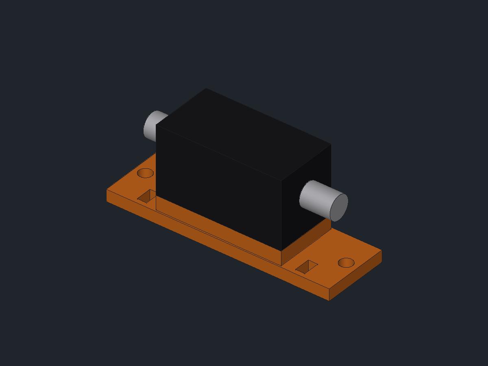

# BTT SFS V2.0 holder (Trad Rack)

Inline holder for the BTT SFS V2.0 filament sensor (switch + motion encoder) on the shared bowden,
right where it leaves the Trad Rack cable chain's fixed end. All 8 lanes have merged there, so one
sensor covers every lane, and nothing is added to the toolhead. Config, wiring guide and
commissioning checklist: simplecore-config `config/sfs_v2.cfg`, `docs/sfs-v2.md`.

## Files
- `sfs-v2-holder.stl` / `.step`: the printed part (world coordinates, as placed in the printer).
- `sfs-v2-holder.gcode`: sliced with `orca-slice` (SimpleCore / Parts 0.2 / ABS Sunlu, `wall_loops=4`,
  supports off, **no brim**). 23 min, 14.3 g, 55 layers. **Not uploaded or printed: printing needs
  Jonas's go.**
- Model: studio "SFS V2 holder", assembly "SFS V2 filament sensor" (holder, SFS block, 2 push-fits),
  instanced in Printer, in both `X-carriage.json` and `X-carriage-no-belts.json`.
- Rebuild: `cd scripts/sfs && python3 mk.py && cad-app run run.json` (model + renders),
  `python3 mk.py print && cad-app run run-print.json` (STL/STEP), then
  `python3 splice.py ../../X-carriage.json ../../X-carriage-no-belts.json` on a fresh `main`.

## Fitting
- Print plate-face down, no supports, no brim (the M3 counterbore ceilings bridge).
- SFS onto the holder: 3× M3×10 SHCS from below into the SFS's heat-set inserts. Heads sit in 5 mm counterbores.
- Holder onto the Trad Rack 2020 extrusion's **top slot**: 2× M5×10 SHCS + M5 T-nuts, on the motor side
  of the chain anchor, with the SFS's anchor-side push-fit 10–15 mm from the anchor. The screws are
  16 mm past each end of the sensor, clear of its fittings.
- The 6 mm seat lifts the SFS's filament axis to the height where the bowden leaves the chain (model:
  Trad Rack z 57.7 vs 58.5).
- Two cable-tie slots for the sensor lead on the panel side.

## Clearances (model; Jonas's extrusion is longer than the model's, so slide the holder to fit)
Positions measured from the Trad Rack STEP with `scripts/sfs/step_bboxes.py` (rCAD times out
importing the whole Trad Rack). Trad Rack frame → world: x_w = 166.7 − x, y_w = −87.1 − y, z_w = 311.5 + z.
- Side panel: 6.1 mm. Selector carriage path (parts above the extrusion top stay at Trad Rack y ≥ −17.94): 6.9 mm.
- Chain anchor: 11 mm (plate end). Motor Mount Lower: 2.4 mm (plate end). The cable chain's fixed
  run never reaches past the anchor towards the motor, wherever the carriage is.
- Nothing else in the Trad Rack model intersects the holder or sensor envelope.
- Not checked against the real machine: where the bowden goes after the chain on Jonas's unit, or
  the real chain anchor position.
